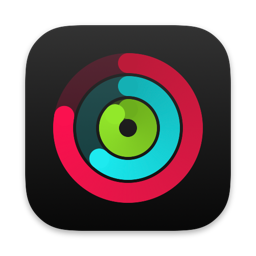
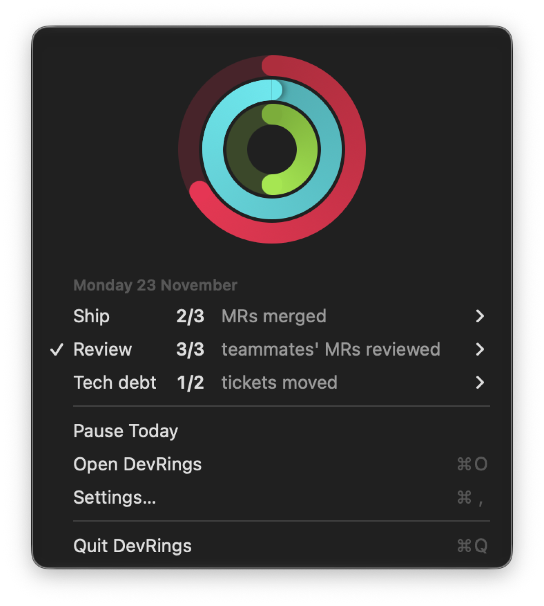
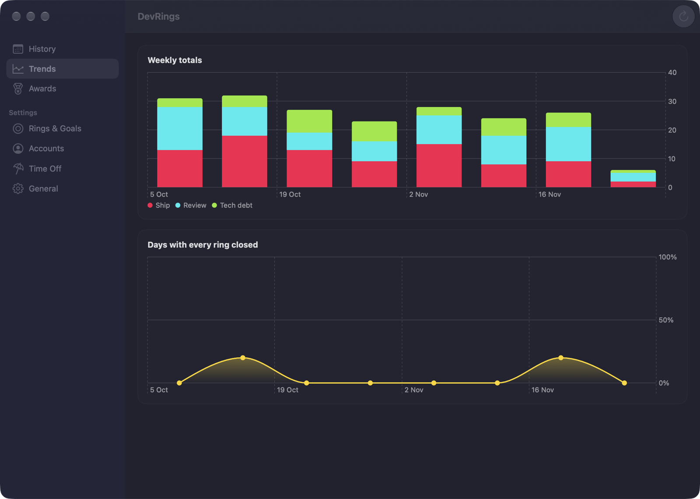

<p align="center">
  
</p>

<h1 align="center">DevRings</h1>

<p align="center">
  Close your rings for the work that matters.<br>
  A native macOS menu bar app that turns a developer's day into three rings: <b>Ship</b>, <b>Review</b> and a ticket ring you define.
</p>

<p align="center">
  
</p>

## Why

Commit graphs reward volume. DevRings rewards a balanced day: getting your own work merged, unblocking your teammates with reviews, and chipping away at the tickets you care about, such as tech debt or bugs. It fills itself in from GitLab and Jira, and everything stays on your Mac.

## The rings

| Ring | Counts | Default goal |
|---|---|---|
| 🔴 **Ship** | Your own merge requests merged that day | 3 |
| 🔵 **Review** | Teammates' MRs you commented on, approved or merged, once per MR per day | 3 |
| 🟢 **Ticket ring** (optional) | Tickets you moved that day that match a filter you build from Jira labels, projects and epics, or raw JQL | 2 |

Ten comments and two approvals on one MR count as one review. Rings only run on your working days, and a streak is consecutive working days with every ring closed.

## Features

- **Menu bar rings** drawn natively, with an animated popover showing what counted toward each ring. Each item opens in your browser.
- **History**: a month calendar of mini rings. Click a day to see what you shipped, reviewed and moved. MRs that mention a Jira key link to the ticket, and tickets link back to the MRs that mention them.
- **Trends**: weekly totals and how often you closed every ring.
- **Awards**: 3D medals rendered in SceneKit. Hover to tilt them, and click to spin one over and see the date engraved on the back.
- **Time off**: pause today, add date ranges, or let a day with no activity count as time off so a forgotten day off doesn't break your streak.
- **Ticket ring setup**: pick labels, a project and an epic from your Jira site, and preview how many tickets matched on each of your last 10 working days before you set a goal.
- **Private by design**: no backend and no analytics. Tokens live in the Keychain and history is a JSON file in Application Support.

<p align="center">
  
</p>

<p align="center">
  
  
</p>

<p align="center">
  
</p>

## Requirements

- macOS 14 Sonoma or later
- Swift 6 with the Command Line Tools. Full Xcode isn't needed.
- A GitLab account: gitlab.com sign-in, or a personal access token with `read_api` for self-hosted
- For the ticket ring, a Jira Cloud site with your email address and an API token

## Build and run

```sh
git clone git@github.com:Leeoc/devrings.git
cd devrings
scripts/bundle.sh          # builds build/DevRings.app and signs it ad hoc
open build/DevRings.app
```

Then open **Settings › Accounts** from the menu:

- **GitLab:** click **Sign In with GitLab…**. A secure sign-in sheet opens, and if you're already signed in to gitlab.com in your browser it's a single click. DevRings asks only for `read_api`, uses OAuth with PKCE, and never holds a client secret. For self-hosted GitLab, choose **Use an access token instead**.
- **Jira Cloud** (only needed for a ticket ring): enter your site (`your-team` is enough), your email and an [API token](https://id.atlassian.com/manage-profile/security/api-tokens). Atlassian doesn't offer app sign-in for Jira Cloud yet. Classic tokens work as they are; a scoped token needs `read:jira-work` and `read:jira-user`.

Tokens are kept in your Keychain. Once GitLab is connected, the app fills in your last 30 working days so History isn't empty on day one.

To see the app with made-up data and no accounts:

```sh
open build/DevRings.app --args --fixture --open-window history
```

## Tests

`swift test` doesn't run Swift Testing suites with only the Command Line Tools installed, so the tests are an executable:

```sh
swift run DevRingsCoreTests
```

They cover the ring, streak, pause and award rules against fixed histories, the JQL builder, and GitLab and Jira parsing against recorded API responses.

## Project layout

```
Sources/DevRingsCore/     Rules, models, storage and providers (Foundation only, fully testable)
  Model/                  Rings, days, settings, ticket filters
  Rules/                  History (working days, pauses, streaks) and awards
  Providers/              CodeHost + GitLab, WorkTracker + Jira, Keychain, HTTP
Sources/DevRings/         The SwiftUI and AppKit app
  StatusItem.swift        Menu bar icon and menu
  History/  Awards/       Main window panes
  Settings/               Rings & Goals, Accounts, Time Off, General
Tests/DevRingsCoreTests/  Swift Testing suite and recorded fixtures
scripts/bundle.sh         Builds, renders the app icon, assembles and signs the .app
```

## Roadmap

- Goal suggestions that raise or lower a goal based on your last few weeks, as Fitness does
- A monthly challenge
- A morning recap notification, and a reveal animation for newly earned awards
- Calendar-based time off (for example, all-day "OOO" events)
- GitHub and Linear providers. The `CodeHost` and `WorkTracker` protocols are ready for them.
- A signed, notarised release and a Homebrew cask

## Licence

[MIT](LICENSE)

DevRings isn't affiliated with Apple, GitLab or Atlassian.
