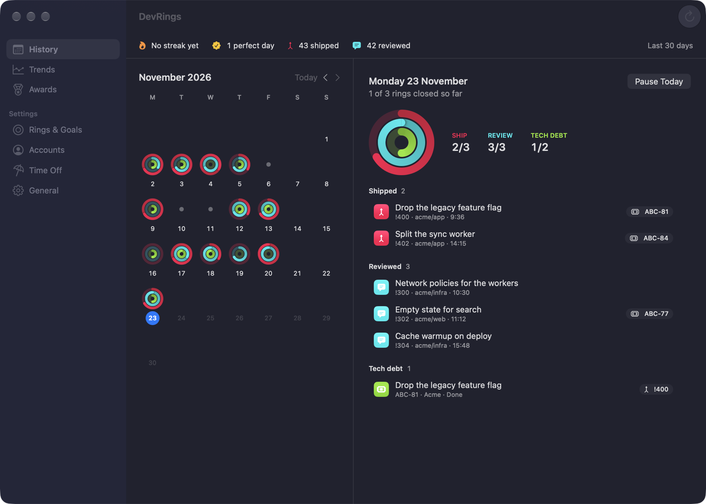
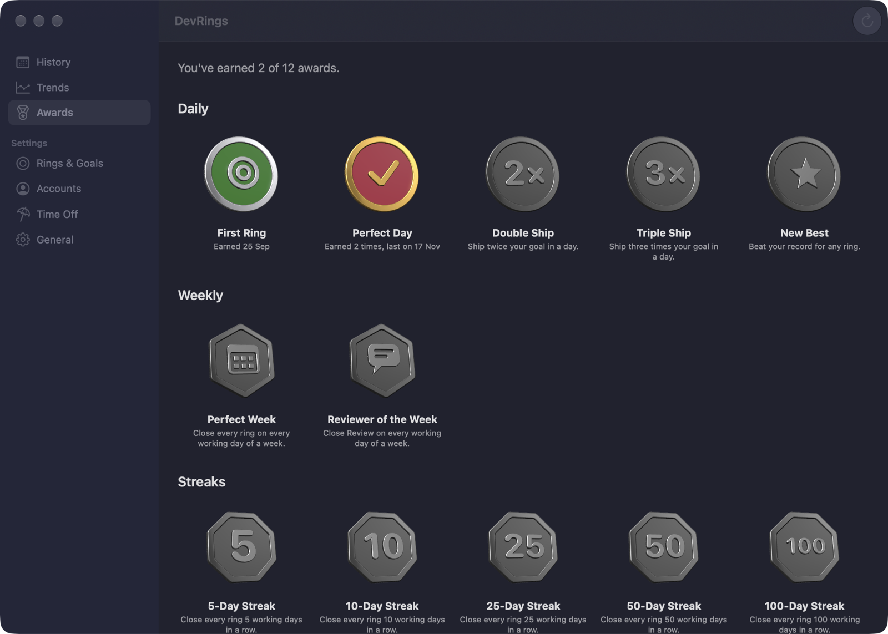
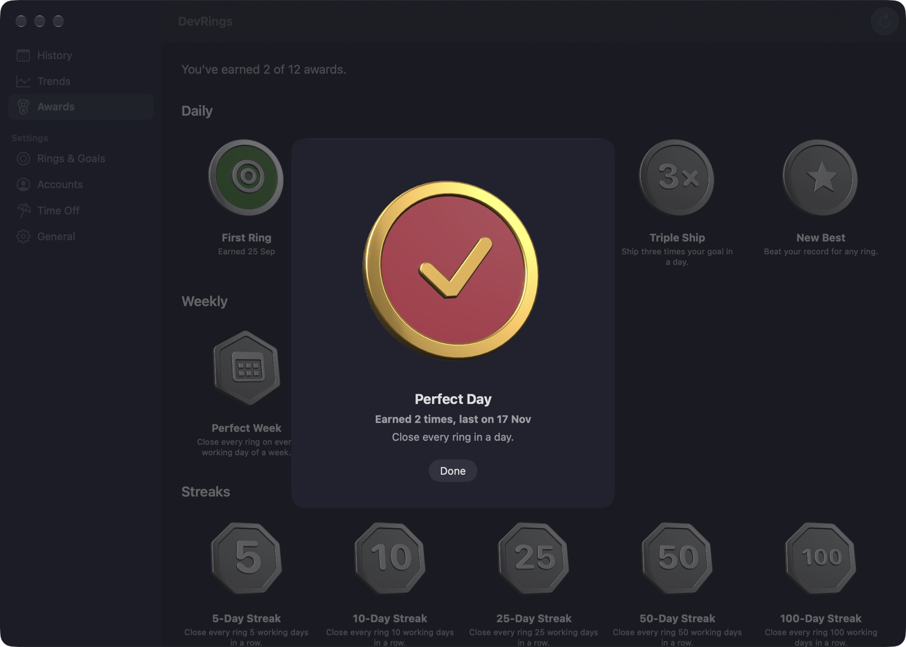

<p align="center">
  
</p>

<h1 align="center">DevRings</h1>

<p align="center">
  Close your rings for the work that matters.<br>
  A native macOS menu bar app that turns a developer's day into three rings: <b>Ship</b>, <b>Review</b> and a ticket ring you define.
</p>

<p align="center">
  <a href="https://github.com/Leeoc/devrings/actions/workflows/ci.yml"></a>
</p>

<p align="center">
  
</p>

## Why

Commit graphs reward volume. DevRings rewards a balanced day: getting your own work merged, unblocking your teammates with reviews, and chipping away at the tickets you care about, such as tech debt or bugs. It fills itself in from GitLab or GitHub, and Jira, and everything stays on your Mac.

## The rings

| Ring | Counts | Default goal |
|---|---|---|
| 🔴 **Ship** | Your own merge or pull requests merged that day | 3 |
| 🔵 **Review** | Teammates' MRs or PRs you commented on, approved or reviewed, once per MR or PR per day | 3 |
| 🟢 **Ticket ring** (optional) | Tickets you moved that day that match a filter you build from Jira labels, projects and epics, or raw JQL | 2 |

Ten comments and two approvals on one MR count as one review. Rings only run on your working days, and a streak is consecutive working days with every ring closed.

## Features

- **Menu bar rings** drawn natively, with an animated popover showing what counted toward each ring. Each item opens in your browser.
- **History**: a month calendar of mini rings. Click a day to see what you shipped, reviewed and moved. MRs that mention a Jira key link to the ticket, and tickets link back to the MRs that mention them.
- **Trends**: weekly totals and how often you closed every ring.
- **Awards**: 3D medals rendered in SceneKit. Hover to tilt them, and click to spin one over and see the date engraved on the back.
- **Notifications**: a note when you close a ring, a nudge at 15:00 if one is still open, and a morning recap of your last working day with your streak and any awards. Each can be turned off or retimed in Settings › General.
- **Time off**: pause today, add date ranges, or let a day with no activity count as time off so a forgotten day off doesn't break your streak.
- **Ticket ring setup**: pick labels, a project and an epic from your Jira site, and preview how many tickets matched on each of your last 10 working days before you set a goal.
- **Private by design**: no backend and no analytics. Tokens live in the Keychain and history is a JSON file in Application Support.

<p align="center">
  
</p>

<p align="center">
  
  
</p>

<p align="center">
  
</p>

## Requirements

- macOS 14 Sonoma or later
- Swift 6 with the Command Line Tools. Full Xcode isn't needed.
- A GitLab account (gitlab.com sign-in, or a personal access token with `read_api` for self-hosted), a GitHub account with a read-only token, or both
- For the ticket ring, a Jira Cloud site with your email address and an API token

## Install

```sh
brew install --cask leeoc/tap/devrings
```

Releases are signed ad hoc rather than notarised by Apple, so the cask clears macOS's quarantine flag after installing. If you download the zip from Releases yourself, do the same once before opening it:

```sh
xattr -dr com.apple.quarantine /Applications/DevRings.app
```

DevRings needs an Apple silicon Mac on macOS 14 or later.

## Build and run

```sh
git clone git@github.com:Leeoc/devrings.git
cd devrings
scripts/dev-cert.sh        # once: a local signing certificate, so rebuilds don't re-ask for Keychain access
scripts/bundle.sh          # builds and signs build/DevRings.app
open build/DevRings.app
```

`dev-cert.sh` adds a self-signed "DevRings Dev" certificate to your login keychain. Without it, builds are signed ad hoc, which gives each build a new identity, so macOS asks again for access to DevRings' tokens after every rebuild.

On first launch a short welcome walks you through connecting accounts, working days and goals. You can reopen it from Settings › General, or set things up yourself in **Settings › Accounts**:

- **GitLab:** click **Sign In with GitLab…**. A secure sign-in sheet opens, and if you're already signed in to gitlab.com in your browser it's a single click. DevRings asks only for `read_api`, uses OAuth with PKCE, and never holds a client secret. For self-hosted GitLab, choose **Use an access token instead**.
- **GitHub:** click **Create Token** to open GitHub's fine-grained token page already filled in with read-only access to pull requests, set the resource owner to your organisation for work repositories, then paste the token. GitHub Enterprise Server works too. You can connect GitLab and GitHub together; both count toward the same rings.
- **Jira Cloud** (only needed for a ticket ring): enter your site (`your-team` is enough), your email and an [API token](https://id.atlassian.com/manage-profile/security/api-tokens). Atlassian doesn't offer app sign-in for Jira Cloud yet. Classic tokens work as they are; a scoped token needs `read:jira-work` and `read:jira-user`.

Tokens are kept in your Keychain. Once a code host is connected, the app fills in your last 30 working days so History isn't empty on day one.

To see the app with made-up data and no accounts:

```sh
open build/DevRings.app --args --fixture --open-window history
```

## Tests

`swift test` doesn't run Swift Testing suites with only the Command Line Tools installed, so the tests are an executable:

```sh
swift run DevRingsCoreTests
```

They cover the ring, streak, pause and award rules against fixed histories, the JQL builder, and GitLab, GitHub and Jira parsing against recorded API responses.

## Releasing

Push a tag like `v1.2.0`. The Release workflow runs the tests, builds `DevRings-1.2.0.zip` with `scripts/release.sh`, and publishes a GitHub release with the zip and its SHA-256. Then update `version` and `sha256` in `Casks/devrings.rb` in the tap; `packaging/homebrew/devrings.rb` is the template.

## Project layout

```
Sources/DevRingsCore/     Rules, models, storage and providers (Foundation only, fully testable)
  Model/                  Rings, days, settings, ticket filters
  Rules/                  History (working days, pauses, streaks) and awards
  Providers/              CodeHost + GitLab and GitHub, WorkTracker + Jira, Keychain, HTTP
Sources/DevRings/         The SwiftUI and AppKit app
  StatusItem.swift        Menu bar icon and menu
  History/  Awards/       Main window panes
  Settings/               Rings & Goals, Accounts, Time Off, General
Tests/DevRingsCoreTests/  Swift Testing suite and recorded fixtures
scripts/bundle.sh         Builds, renders the app icon, assembles and signs the .app
```

## Roadmap

- Goal suggestions that raise or lower a goal based on your last few weeks, as Fitness does
- A monthly challenge
- A reveal animation for newly earned awards
- Calendar-based time off (for example, all-day "OOO" events)
- GitHub sign-in with the device flow, and a Linear provider

## Contributing

DevRings is a one-person project for now, so I'm not taking pull requests or feature requests. You're welcome to use it, fork it and build on it under the licence.

## Licence

[MIT](LICENSE)

DevRings isn't affiliated with Apple, GitLab, GitHub or Atlassian.
